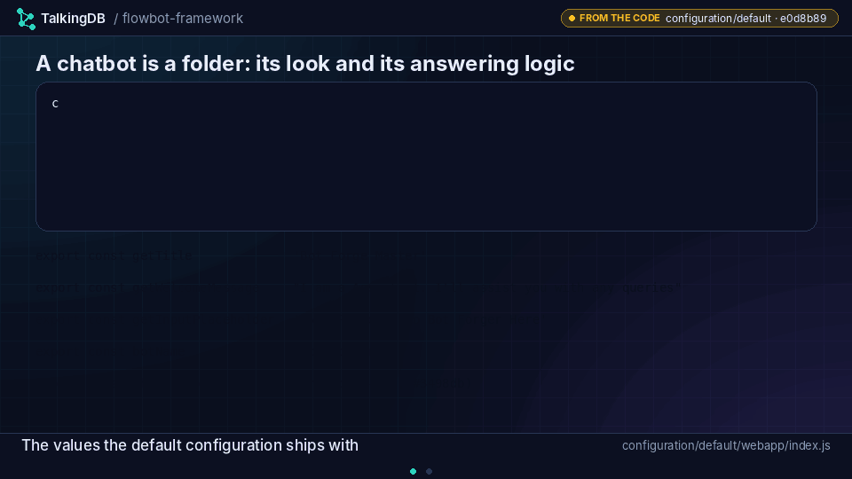

<!-- short-readme -->
<h1 align="center">Flowbot</h1>

<p align="center"><b>A chat app framework for AI agents and business processes.</b></p>

<p align="center"><a href="#try-it">Try it</a> · <a href="docs/architecture.md">How it works</a> · <a href="docs/usage-and-examples.md">Usage and examples</a> · <a href="docs/troubleshooting.md">Troubleshooting</a> · <a href="docs/reference.md">Full reference</a></p>

<p align="center"><a href="https://github.com/TalkingDB/flowbot-framework/stargazers"></a> <a href="https://www.gnu.org/licenses/agpl-3.0.html"></a></p>

<p align="center">
  
</p>
<p align="center"><sub>Drawn from <code>configuration/default</code> and <a href="docs/architecture.md">Architecture</a>.</sub></p>

Flowbot gives you the web app, sign in, chat history, admin pages, sharing and streaming. Each chatbot plugs in as a small **configuration** folder that decides how it looks and how questions are answered.

## What it does

- **Look**: `configuration/<chat-id>/webapp` sets the title, welcome text and colours.
- **Logic**: `configuration/<chat-id>/server` answers each question ([the contract](docs/architecture.md)).
- **Everything else** (sign in, history in [MongoDB](https://www.mongodb.com/docs/), streaming) is the framework's job ([usage](docs/usage-and-examples.md)).

## Try it

```bash
cp .env.example .env
yarn install
yarn dev                 # http://localhost:3000/?chat-id=default
```

Or with Docker: `./develop.sh`.

## Where it fits

[flowbot-chatbot-ttt](https://github.com/TalkingDB/flowbot-chatbot-ttt) is the TalkingDB document chat built on it.

## Learn more

| Page | Read it to |
| :--- | :--- |
| [How it works](docs/architecture.md) | see the parts and how data moves |
| [Usage and examples](docs/usage-and-examples.md) | copy working examples |
| [Troubleshooting](docs/troubleshooting.md) | fix a problem |
| [Full reference](docs/reference.md) | read everything that used to be on this page |
| [All docs](docs/README.md) | see every page |

## Support TalkingDB

If flowbot-framework saved you time, please [give it a star](https://github.com/TalkingDB/flowbot-framework) ⭐. Stars help other developers find the project.

Found a bug, or a document it gets wrong? [Open an issue](https://github.com/TalkingDB/flowbot-framework/issues/new). We are always here to help and open to a conversation. Explore the TalkingDB applications at [talkingdb.io](https://talkingdb.io/#applications).

## License

GNU Affero General Public License v3.0 ([AGPL-3.0](https://www.gnu.org/licenses/agpl-3.0.html)). See [LICENSE](LICENSE).
