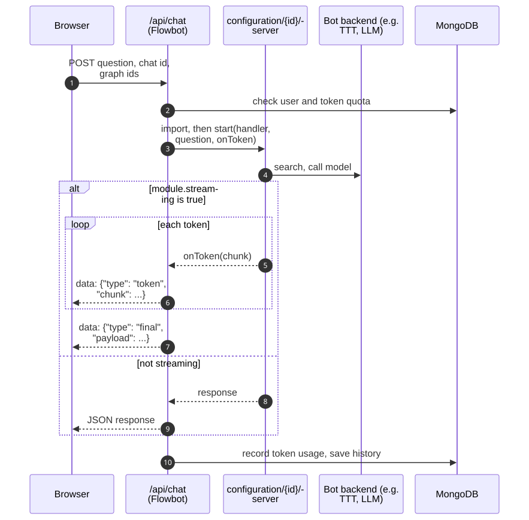

# Architecture

[Docs home](README.md) › Architecture

How a chat request flows through Flowbot, and the contract a chatbot configuration must meet. For setup, start at the [README](../README.md).

## One question, end to end

<picture>
  <source media="(prefers-color-scheme: dark)" srcset="images/one-chat-question-through-flowbot-dark.svg">
  
</picture>

Diagram source: [one-chat-question-through-flowbot.mmd](diagrams/one-chat-question-through-flowbot.mmd). Edit it and re-render with the steps in [docs/diagrams](diagrams/README.md).

In words: Flowbot authenticates the user, hands the question to the chatbot's own server code, relays its answer to the browser as it is produced, and records usage and history.

The handler object passed to `start` includes `user`, `graphIds`, `chatBotId`, `headers` (with the TTT service authorization), `reqQuery`, `reqBody`, an `axiosInstance` and a few parsing helpers ([`pages/api/chat.ts`](../pages/api/chat.ts)).

## Choosing the configuration

1. The page reads `chat-id` from the URL, or falls back to `NEXT_PUBLIC_DEFAULT_CHAT_ID` ([`components/layout.tsx`](../components/layout.tsx)).
2. The browser imports `configuration/{chat-id}/webapp` and its `Index.module.css`. If either is missing, `configuration/default` is used.
3. The chat API imports `configuration/{chat-id}/server`, falling back to `configuration/default/server`.

Configurations are resolved at **build time** by [Next.js](https://nextjs.org/docs), so a configuration must be inside `configuration/` before `yarn build` (or the [Docker](https://docs.docker.com/get-started/docker-overview/) build). [`deploy.sh`](../deploy.sh) copies `../configurations/*` into `./configuration/` for that reason.

## The configuration contract

Taken from the two configurations in this repository and from [flowbot-chatbot-ttt](https://github.com/TalkingDB/flowbot-chatbot-ttt):

| File | Export | Meaning |
| :--- | :--- | :--- |
| `server/index.js` | `start(handler, question, onToken)` | Required. Answers one question; returns the response |
| `server/index.js` | `streaming` | `true` to stream tokens through `onToken` |
| `server/index.js` | `conversational`, `pollingInterval`, `openid` | Conversation mode, client polling interval, sign in settings |
| `webapp/index.js` | `getTitle`, `getWelcomeMessage`, `getInputPlaceholder`, `botName` | Text in the chat window |
| `webapp/index.js` | `themeColor`, `sendIcon`, `Navbar`, `leftPanelEnabled`, `hideEditButton`, `showUserResponseFirst` | Look and layout switches |
| `webapp/index.js` | `enabled` | Turn the chatbot on or off |
| `webapp/Index.module.css` | CSS module | Styling for this chatbot |

## Folder map

| Folder | Holds |
| :--- | :--- |
| [`pages/`](../pages/) | Screens (`index`, `Chatbot`, `admin`, `share`) and API routes under `pages/api/` (chat, history, users, uploads, feedback, Slack events, payments) |
| [`components/`](../components/) | [React](https://react.dev/learn) components, including the layout that loads configurations |
| [`configuration/`](../configuration/) | Chatbot configurations (`default`, `bot-forger`) |
| [`models/`](../models/), [`config/`](../config/) | MongoDB models and connection, legacy Pinecone settings |
| [`scripts/`](../scripts/) | `ingest-data.ts`, run with `yarn ingest` |
| `docker-compose*.yml`, `Dockerfile*` | Local and production containers |

---

**Related:** [Troubleshooting](troubleshooting.md) · [Usage and examples](usage-and-examples.md) · [README](../README.md)
