# Flowbot: full reference

[Back to the README](../README.md)

Everything that was on the front page before it was shortened, unchanged apart from links, so nothing is lost.

A chat application framework for AI agents and business processes. Flowbot provides the web app, sign in, chat history, admin pages, sharing and streaming; each chatbot plugs in as a small **configuration** folder that decides how questions are answered and how the chat looks.


| Start here | Go deeper |
| :--- | :--- |
| [How a chatbot plugs in](#how-a-chatbot-plugs-in) | [Architecture: request flow and the configuration contract](architecture.md) |
| [Quickstart](#quickstart) | [Usage and examples: add a chatbot, run, deploy](usage-and-examples.md) |
| [Configuration variables](#configuration-variables) | [Troubleshooting](troubleshooting.md) |
| [What this repo is not](#what-this-repo-is-not) | [Example chatbot: flowbot-chatbot-ttt](https://github.com/TalkingDB/flowbot-chatbot-ttt) |

All pages: [docs/](README.md).

## How a chatbot plugs in

<picture>
  <source media="(prefers-color-scheme: dark)" srcset="images/how-flowbot-loads-a-chatbot-configuration-dark.svg">
  
</picture>

<sub>Diagram source: [how-flowbot-loads-a-chatbot-configuration.mmd](diagrams/how-flowbot-loads-a-chatbot-configuration.mmd). Edit it and re-render with the steps in [docs/diagrams](diagrams/README.md).</sub>

In words: Flowbot is the shell; the chatbot folder named by `chat-id` supplies the look (`webapp`) and the answering logic (`server`), and Flowbot streams its answer to the browser and keeps the history.

Configurations live in [`configuration/`](../configuration/). Two ship with this repository: [`default`](../configuration/default/) and [`bot-forger`](../configuration/bot-forger/). Others, such as [flowbot-chatbot-ttt](https://github.com/TalkingDB/flowbot-chatbot-ttt), live in their own repositories and are copied in at deploy time.

## Quickstart

You need Node.js 18 and Yarn, or [Docker](https://docs.docker.com/get-started/docker-overview/). MongoDB is required for sign in and history ([Docker Compose](https://docs.docker.com/compose/) starts one for you).

```bash
cp .env.example .env          # fill in the values; see the table below
yarn install
yarn dev                      # http://localhost:3000
```

With Docker:

```bash
./develop.sh                  # docker compose -f docker-compose-dev.yml up --build -d
```

Open `http://localhost:3000/?chat-id=default`, or set `NEXT_PUBLIC_DEFAULT_CHAT_ID` to choose the chatbot shown without a `chat-id`.

## Configuration variables

From [`.env.example`](../.env.example):

| Variable | Used for |
| :--- | :--- |
| `MONGODB_URI`, `MONGO_USER`, `MONGO_PSSWD` | Users and chat history |
| `NEXT_PUBLIC_CHAT_HOST`, `NEXT_PUBLIC_NEXTAUTH_URL` | Public URLs of this app |
| `NEXT_PUBLIC_DEFAULT_CHAT_ID` | Chatbot used when the URL has no `chat-id` |
| `NEXT_PUBLIC_TDB_TTT_SERVICE`, `NEXT_PUBLIC_TDB_TTT_SERVICE_AUTHORIZATION` | The TalkingDB TTT service and its key, passed to chatbots that search documents |
| `NEXT_PUBLIC_BACKEND_CONNECTOR_HOST`, `NEXT_PUBLIC_BACKEND_CONNECTOR_KEY`, `NEXT_PUBLIC_BACKEND_TEXT_SIMILARITY` | Other backends a chatbot may call |
| `GPT_BEARER_TOKEN` | [LLM](https://en.wikipedia.org/wiki/Large_language_model) access for chatbots that need it |
| `NEXT_PUBLIC_GOOGLE_CLIENT_ID`, `CLIENT_SECRET`, `OAUTH_TOKEN_ENDPOINT_ALLOWLIST` | Google sign in |
| `SESSION_SECRET` | Session signing |
| `ADMIN_EMAILS` | Who can open the admin pages |
| `SENTRY_IGNORE_API_RESOLUTION_ERROR` | Sentry setting |

> [!CAUTION]
> Variables starting with `NEXT_PUBLIC_` are built into the JavaScript that browsers download. Anything secret in one of them, such as a service authorization key, is visible to every visitor. Prefer server side variables for secrets.

## What this repo is not

- **Not a chatbot by itself.** Answers come from the configuration's `server` module; without one, the `default` configuration is used.
- **Not a search engine.** Document search is done by the service a chatbot calls, such as [module-ttt](https://github.com/TalkingDB/module-ttt).
- **Not a TalkingDB library.** It is a JavaScript application; TalkingDB services are reached over HTTP.

## Related repositories

| Repository | Relationship |
| :--- | :--- |
| [flowbot-chatbot-ttt](https://github.com/TalkingDB/flowbot-chatbot-ttt) | The TTT document chat configuration that runs on Flowbot |
| [module-ttt](https://github.com/TalkingDB/module-ttt) | Document search used by that configuration |
| [infra-tdb-platform](https://github.com/TalkingDB/infra-tdb-platform) | Lists Flowbot in the Backstage catalogue |

## Further reading

- [Next.js pages router](https://nextjs.org/docs/pages)
- [Server Sent Events](https://developer.mozilla.org/en-US/docs/Web/API/Server-sent_events/Using_server-sent_events)
- [Next.js environment variables](https://nextjs.org/docs/pages/guides/environment-variables)
- [MongoDB with Mongoose](https://mongoosejs.com/docs/)

## Contributor

Mayank Gupta, mayank.g@smarter.codes
